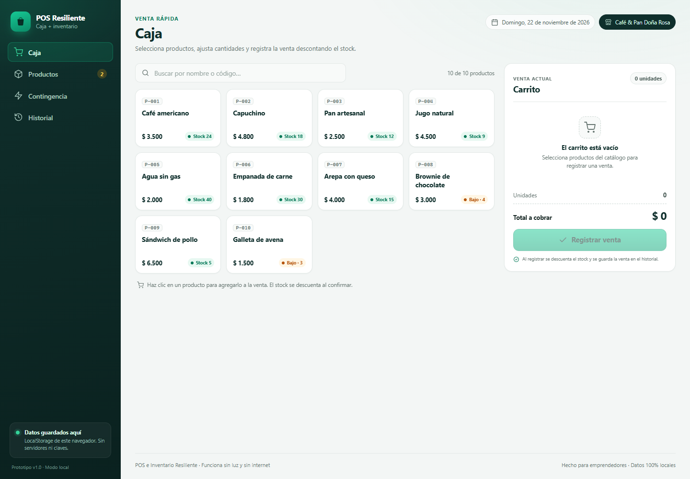
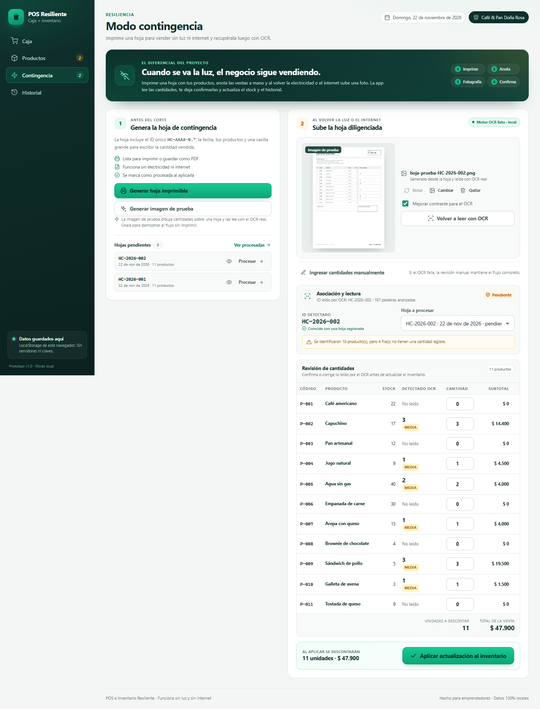
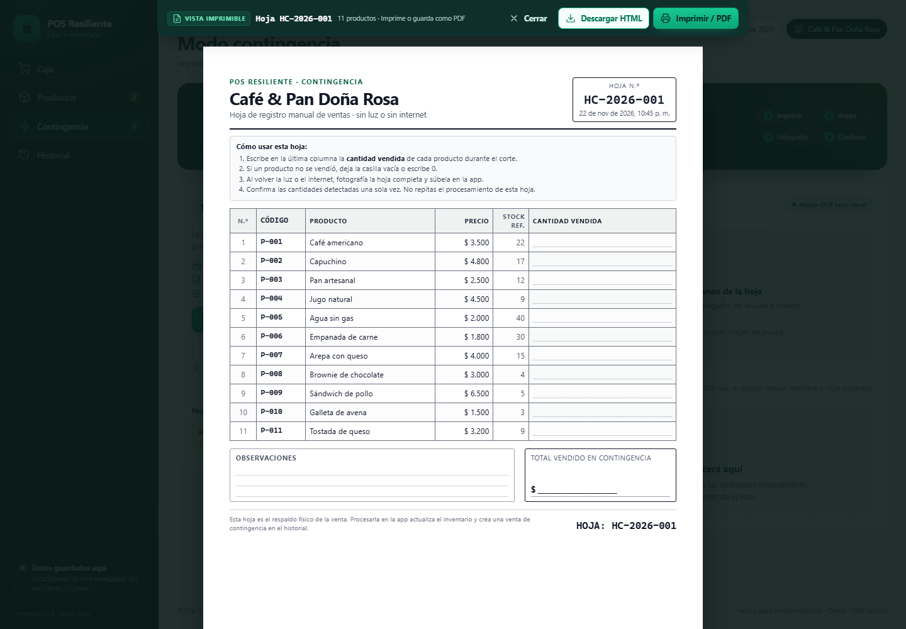
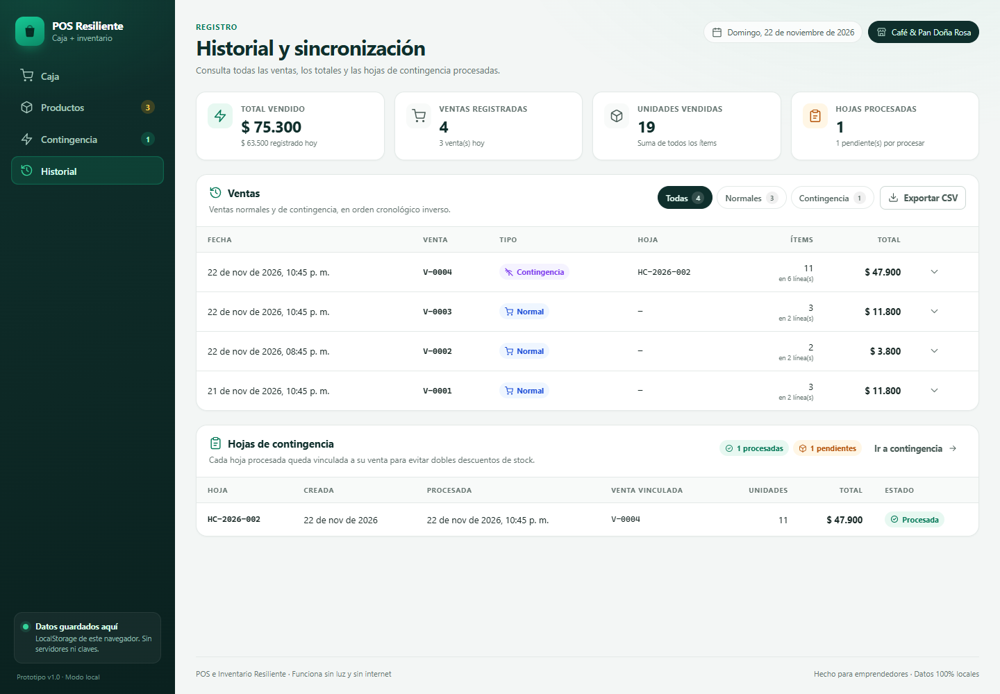

# POS e Inventario Resiliente para Emprendedores

Prototipo web local de punto de venta (POS) con inventario, hoja de contingencia imprimible y recuperación de ventas mediante OCR real en el navegador.

El proyecto demuestra un flujo completo para pequeños negocios:

1. Vender normalmente y descontar stock.
2. Imprimir una hoja para seguir vendiendo sin luz ni internet.
3. Fotografiar la hoja diligenciada, leer las cantidades con OCR, revisarlas y sincronizar el inventario sin duplicar descuentos.

No usa backend, servicios pagos ni claves de API. Los datos se guardan en `localStorage` del navegador.

---

## Requisitos

- **Node.js 20.19+ o 22.12+** (probado con Node 24).
- npm incluido con Node.
- Navegador moderno: Edge, Chrome o Firefox reciente.
- Para OCR local: los archivos ya están incluidos en `public/tesseract/` (no requiere internet).
- Opcional para la prueba E2E: Microsoft Edge o Google Chrome instalado.

---

## Inicio rápido

Desde la carpeta del proyecto:

```bash
npm install
npm run dev
```

Vite abrirá automáticamente `http://localhost:5173/`.

### En Windows con doble clic

Ejecuta:

```text
iniciar.bat
```

El archivo instala las dependencias si hace falta y arranca la aplicación.

### Build de producción

```bash
npm run build
npm run preview
```

Abre `http://localhost:4173/`. El OCR local también funciona desde `dist/`.

---

## Los 3 flujos principales

### Flujo 1 · Venta normal y descuento de stock

1. Entra a **Caja**.
2. Haz clic en **Café americano** dos veces y en **Capuchino** una vez.
3. Verifica el carrito: 3 unidades y total **$ 11.800**.
4. Pulsa **Registrar venta**.
5. Confirma el aviso de venta `V-0003` y observa que el stock de los productos baja.
6. Ve a **Historial** y verifica la venta con su detalle.

También puedes ajustar cantidades con los botones `+` / `−` del carrito antes de registrar.

### Flujo 2 · Hoja de contingencia + OCR + sincronización

1. Entra a **Contingencia**.
2. Pulsa **Generar hoja imprimible**. Se crea una hoja con ID único `HC-AAAA-N.º`.
3. Usa **Imprimir / PDF** o **Descargar HTML** para guardar la hoja.
4. Cierra la vista imprimible.
5. Para probar sin imprimir, pulsa **Generar imagen de prueba**. La app dibuja una hoja diligenciada y la procesa con el OCR real.
6. Espera a que aparezca **Revisión de cantidades**. El motor OCR local debe indicar `Motor OCR listo · local`.
7. Revisa o corrige las cantidades detectadas. El botón **Aplicar actualización al inventario** solo se habilita cuando hay al menos una cantidad.
8. Pulsa **Aplicar actualización al inventario**.
9. Verifica el panel de éxito:
   - Venta de contingencia `V-0004`.
   - Unidades descontadas y total.
   - Hoja marcada como **procesada**.
10. Ve a **Historial** y confirma la venta de contingencia y la hoja procesada.

#### Probar con una foto real

1. Imprime la hoja y anota las cantidades a mano.
2. En **Contingencia**, pulsa **Elegir imagen** y selecciona una foto JPG/PNG de la hoja completa.
3. Pulsa **Leer hoja con OCR**.
4. Corrige cualquier cantidad en la tabla de revisión.
5. Aplica la actualización.

> La revisión siempre es obligatoria. El OCR propone cantidades, pero el usuario confirma antes de modificar el stock.

### Flujo 3 · Historial, totales y protección contra duplicados

1. Entra a **Historial**.
2. Filtra por **Normales** o **Contingencia**.
3. Expande una venta con el botón de detalle para ver productos, cantidades y subtotales.
4. Revisa los indicadores: total vendido, ventas registradas, unidades vendidas y hojas procesadas.
5. En **Hojas de contingencia**, confirma que cada hoja procesada está vinculada a su venta.
6. Pulsa **Exportar CSV** para descargar el historial filtrado.
7. Vuelve a **Contingencia** y verifica que una hoja ya procesada aparece deshabilitada en el selector. El sistema bloquea el doble descuento de stock.

### Reiniciar la demo

1. Ve a **Productos**.
2. En **Datos de demostración**, pulsa **Restaurar datos demo**.
3. Confirma. Se restauran los 10 productos y las 2 ventas iniciales, y se borran las hojas y ventas creadas.

---

## Datos de demostración

- Negocio: **Café & Pan Doña Rosa**.
- 10 productos con códigos `P-001` a `P-010`.
- 2 ventas iniciales: `V-0001` y `V-0002`.
- Alertas de stock bajo en `P-008` (Brownie) y `P-010` (Galleta de avena).
- Los IDs nuevos siguen el formato:
  - Ventas: `V-0001`, `V-0002`, …
  - Hojas: `HC-2026-001`, `HC-2026-002`, …

La información se guarda en la clave `pos_inventario_resiliente_v1` de `localStorage`.

---

## Cómo funciona el OCR

- Motor: **Tesseract.js 7**.
- Archivos locales incluidos:
  - `public/tesseract/worker.min.js`
  - `public/tesseract/core/tesseract-core-simd-lstm.wasm.js` y `.wasm`
  - `public/tesseract/core/tesseract-core-lstm.wasm.js` y `.wasm`
  - `public/tesseract/lang/spa.traineddata.gz`
- Se usa el modo de segmentación automática **PSM 3**, adecuado para hojas con tablas.
- La imagen se procesa en el navegador: no se sube a ningún servidor.
- Si el núcleo local falla, se intenta un núcleo de respaldo y luego un CDN.
- Si el OCR no está disponible, el flujo manual sigue funcionando: **Ingresar cantidades manualmente**.

### Protección contra duplicados

- Cada hoja tiene un ID único.
- Al aplicarla, queda en estado `procesada` y se vincula a la venta generada.
- El modelo valida el estado antes de descontar stock.
- La interfaz deshabilita las hojas procesadas y muestra una advertencia si se intenta reutilizarlas.

---

## Pruebas

### Pruebas unitarias

```bash
npm test
```

Incluye 17 pruebas de:

- Ventas y descuento de stock.
- Validación de stock insuficiente.
- Creación y aplicación de hojas.
- Bloqueo de doble procesamiento.
- Alta, edición y eliminación de productos.
- Parser de OCR (TSV, IDs, cantidades, errores típicos).

### Prueba E2E opcional

Con la app corriendo en `http://localhost:5173/`:

```bash
npm run test:e2e
```

La prueba usa `playwright-core` con Microsoft Edge o Google Chrome instalado. Recorre los flujos completos, incluyendo OCR real, descargas, móvil y restauración de la demo. Las capturas se guardan en `.screenshots/`.

Si usas el build de producción:

```powershell
$env:BASE_URL='http://localhost:4173/'
npm run test:e2e
```

---

## Estructura del proyecto

```text
Inventario_Pos/
├─ public/
│  └─ tesseract/              # Motor, núcleos WASM y diccionario español
├─ scripts/
│  └─ e2e.mjs                 # Prueba de navegador opcional
├─ src/
│  ├─ components/             # Layout, modales, tablas, toasts, hoja imprimible
│  ├─ context/                # Estado global y persistencia
│  ├─ hooks/                  # Navegación por hash
│  ├─ lib/
│  │  ├─ constants.js
│  │  ├─ csv.js
│  │  ├─ format.js
│  │  ├─ model.js             # Reglas puras de ventas, productos y hojas
│  │  ├─ ocr.js               # Inicialización y preprocesamiento del OCR
│  │  ├─ parser.js            # Interpretación del TSV de Tesseract
│  │  ├─ seed.js              # Datos demo
│  │  ├─ sheet.js             # HTML/CSS de la hoja imprimible
│  │  ├─ storage.js           # localStorage versionado
│  │  └─ testImage.js         # Hoja sintética para demostrar el OCR
│  ├─ pages/                  # Caja, Productos, Contingencia, Historial
│  ├─ App.jsx
│  ├─ main.jsx
│  └─ styles.css
├─ tests/
│  ├─ model.test.js
│  └─ parser.test.js
├─ iniciar.bat
├─ package.json
└─ vite.config.js
```

---

## Capturas del prototipo

En la carpeta `capturas/` están las imágenes del recorrido completo (caja, carrito, productos, hoja imprimible, revisión OCR, historial, versión móvil y bloqueo de duplicados).









---

## Notas y limitaciones

- Es un **prototipo académico**, no un sistema de producción.
- Los datos viven en un solo navegador y dispositivo. No hay multiusuario ni sincronización entre equipos.
- El OCR depende de la calidad de la foto: buena luz, hoja completa y letra legible.
- La revisión humana es obligatoria para evitar errores de lectura.
- La moneda está configurada en **COP** con formato `es-CO`.
- La impresión usa CSS `@page A4`; en el diálogo del navegador elige A4 y márgenes predeterminados.
- Si se borra el almacenamiento del navegador, se pierden los datos. Usa **Exportar CSV** como respaldo.

---

## Solución de problemas

**El OCR no carga**

- Verifica que exista `public/tesseract/` y que no esté vacío.
- Si no hay internet y faltan los archivos locales, usa **Ingresar cantidades manualmente**.
- Recarga la página después de restaurar los archivos.

**El puerto 5173 está ocupado**

Vite puede elegir otro puerto; revisa la URL que muestra la terminal. También puedes ejecutar:

```bash
npm run dev -- --port 5180
```

**Quiero empezar de cero**

Ve a **Productos** → **Restaurar datos demo**. También puedes borrar la clave `pos_inventario_resiliente_v1` desde las herramientas del navegador.

---

## Créditos

- Interfaz y lógica: proyecto propio.
- OCR: [Tesseract.js](https://github.com/naptha/tesseract.js) y [tesseract.js-core](https://github.com/naptha/tesseract.js-core).
- Diccionario español: `tessdata` / `tessdata_fast`.
- Licencias incluidas en `public/tesseract/`.
